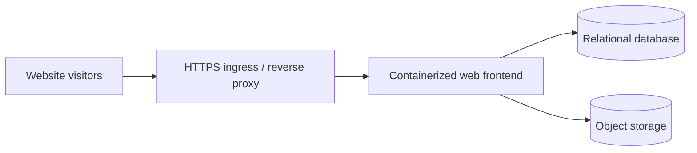
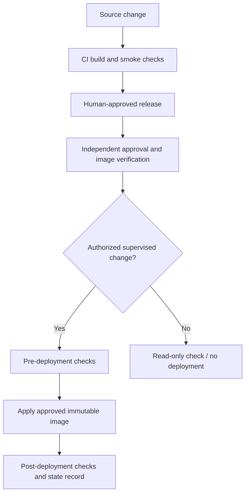

# KU Tech Production Infrastructure & Release Safety

**Role:** Infrastructure Lead, KU Tech (student organization at Kasetsart University)  
**Project period:** 2026 · **Evidence window:** October–November 2026  
**Focus:** Linux · Docker · CI/CD verification · Release safety · Incident response · Backup recovery

> **Public portfolio case study.** This describes my contribution at a high level. Internal host details, deployment commands, security configurations, secrets, operational logs, and private runbooks are intentionally excluded. The outcomes below reflect verified work during the stated evidence window, not a claim about the system's current live state.

## Context

KU Tech operates a public-facing website used by students. As part of the infrastructure team, I worked on maintaining a containerized production application and making releases more predictable, recoverable, and observable.

The environment involved a Linux host, a containerized Next.js frontend, an HTTPS reverse proxy, a relational database, and S3-compatible object storage. I worked on the public frontend and related infrastructure operations; I did **not** own or independently upgrade the separate administration application.

## High-Level Architecture

This intentionally simplified view is **not** a network topology or security configuration diagram.

## My Contributions

### 1. Safer application maintenance

- Updated security-relevant frontend dependencies and checked the application build and production-facing behavior after the changes.
- Removed sensitive authentication-context logging from the frontend release path.
- Kept changes scoped to the frontend rather than modifying unrelated production services or an administration application whose source and ownership were not fully established.

### 2. Approval-aware release verification

I helped implement and validate a guarded deployment workflow that separates **image build**, **human approval**, **independent approval verification**, and **production execution**.

Important engineering safeguards included verifying that the image matched the approved release, validating the pre-deployment state, retaining transaction records, and failing closed when approval or state could not be verified. The routine agent was left in **check-only mode**; unattended execution was **not** permanently enabled.

### 3. Validation and recovery preparation

- Supported **one supervised production frontend rollout**, with approval verification, pre/post-deployment acceptance checks, and a recorded successful transaction.
- Verified public HTTPS reachability and an expected authentication redirect after the rollout. This was **not** a complete end-to-end login test suite.
- Prepared and checked rollback/recovery paths in an isolated rehearsal. No real production rollback was required for that successful release.
- Reviewed scheduled backups and validated PostgreSQL and object-storage restore procedures in **isolated environments**, without replacing live production data.

### 4. Failure visibility and handover

- Configured service-failure notifications and verified the alert path with a controlled test; an observed verification-service failure also generated a notification.
- Used scheduled checks, service journals, and health checks to distinguish a release-verification problem from an actual website outage.
- Documented operational boundaries, troubleshooting checks, change safety rules, and unresolved risks for the next infrastructure maintainers.

## Verification Summary

| Area | Evidence observed during the project | Qualification |
|---|---|---|
| Frontend release | One supervised rollout completed and post-deployment checks passed | Not evidence of ongoing unattended deployment |
| Application availability | Public HTTPS check and expected sign-in redirect succeeded | Not a comprehensive end-to-end user-flow test |
| CI and approval | Build/smoke checks and independent release-approval verification were exercised | Approval alone did not automatically deploy |
| Backup recovery | Database and object-storage restore drills passed in isolation | Full disaster recovery and off-site restore were not verified |
| Notifications | Service-failure alerting was exercised and received | Not a full monitoring or 24/7 paging platform |
| Rollback | Rehearsed in isolation | Not triggered during the successful production release |

## Lessons and Trade-offs

- **Fail closed before changing production.** Missing or stale approval evidence should stop the release path instead of triggering a best-effort deployment.
- **Immutable releases improve traceability.** Using an approved image digest is safer than relying on a mutable tag alone.
- **Health checks have limits.** Passing HTTP and synthetic checks does not prove every authenticated workflow works; deeper tests are still needed.
- **Recovery needs evidence.** A backup job's existence is less valuable than a restore drill, but isolated restore success does not establish full disaster-recovery readiness.
- **Automation needs an explicit activation policy.** A validated supervised rollout should not be presented as an always-on auto-deployment system.

## Outstanding Work at Handover

The following items were **not** claimed as completed: fully unattended deployment, full browser-based OAuth acceptance coverage, production-scale disaster recovery including off-site/configuration recovery, and root-cause resolution of an intermittent approval-export verification issue. These were recorded as follow-up risks rather than silently marked resolved.

## Public Reference

- [KU Tech public source repository](https://github.com/ku-t3ch/ku-tech) — team project; this case study focuses specifically on my infrastructure and release-safety contributions.

**Collaboration and attribution:** Work was performed within KU Tech's team processes. This document does not claim sole ownership of the application, all infrastructure, or all related code.
